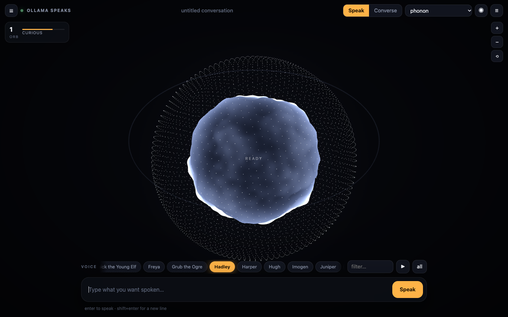
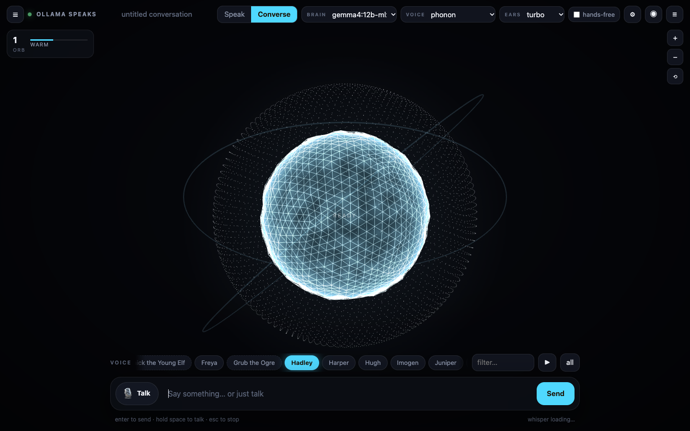
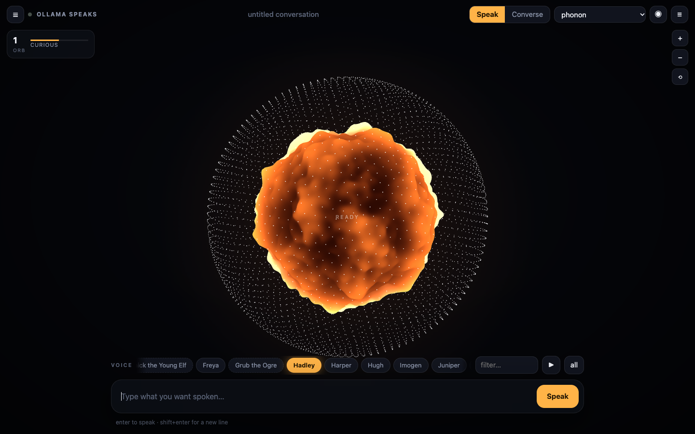
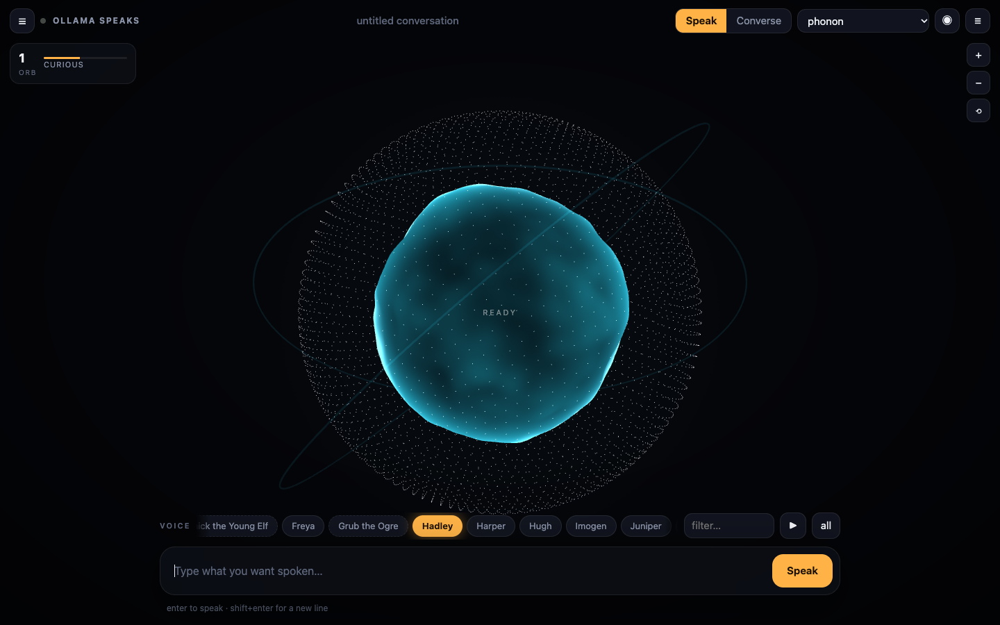
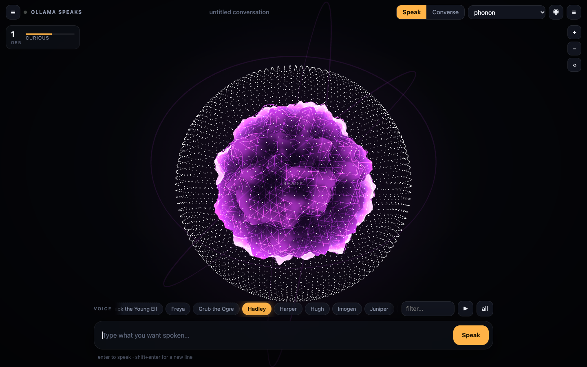
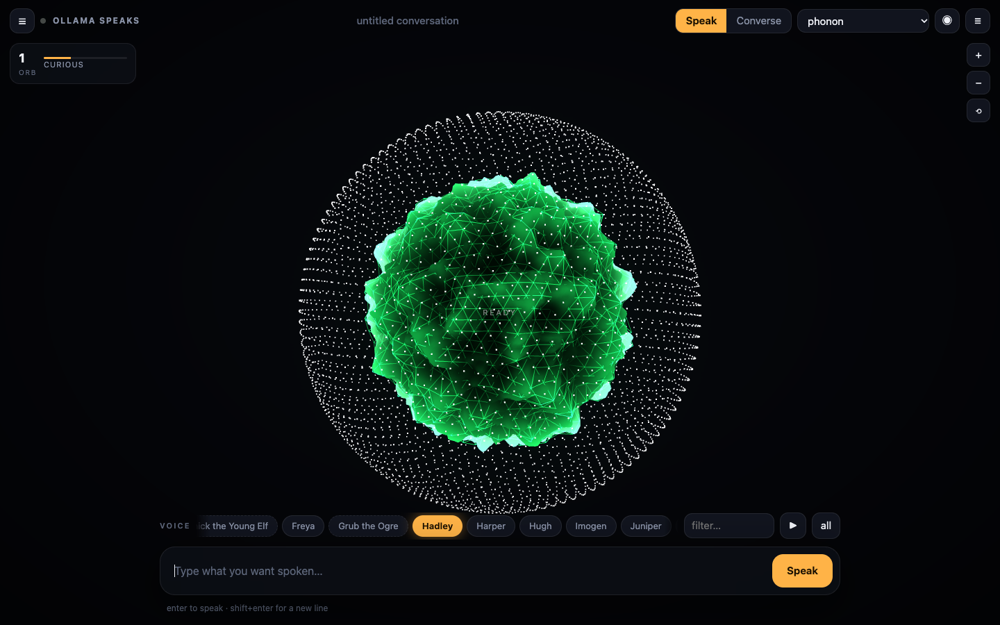
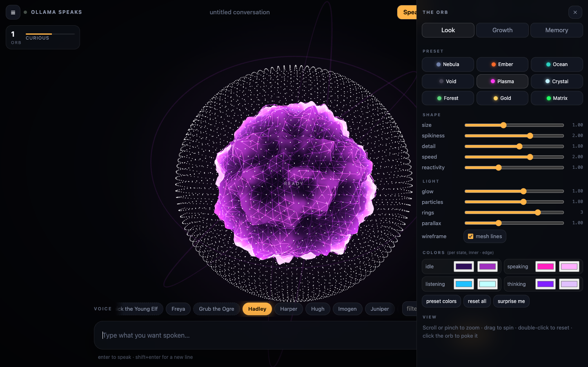
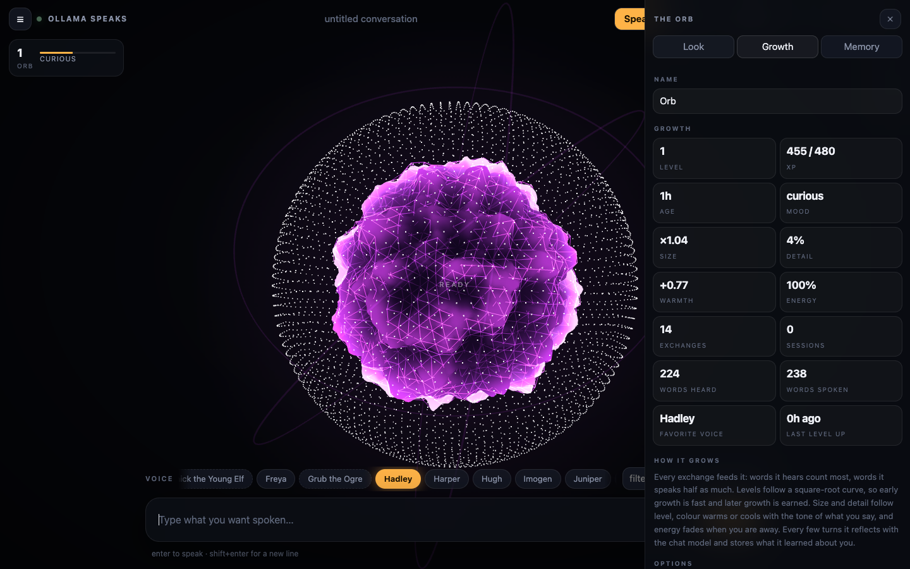
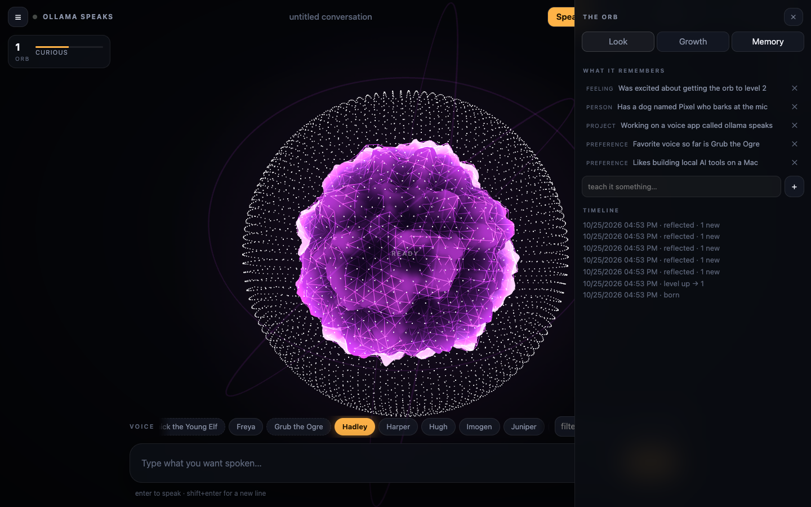

# ollama speaks

A local voice studio for the [speech models in Ollama](https://ollama.com/blog/speech-models).
Type something and hear it in any of Phonon's voices, or have a spoken back-and-forth with a local model
while a 3D orb breathes, listens, thinks and talks in front of you. No cloud, no keys, no chatbot window.



## What it does

- **Speak** mode: type a line, tap a voice button (Hadley, Zoey, Grub the Ogre, The Snow Queen, 38 English voices plus the multilingual set), press Enter. The orb lights up amber and deforms to the audio while it talks.
- **Converse** mode: talk with any chat model you have in Ollama (or a local OpenAI-compatible server). Replies stream sentence by sentence into Phonon so the voice starts within a second. Press **Talk** or hold **space** and speak; turn on **hands-free** and it listens again every time it finishes speaking.
- **Local speech-to-text** with [mlx-whisper](https://github.com/ml-explore/mlx-examples/tree/main/whisper). Pick the ears model in the header (tiny, base, small, medium, large-v3-turbo, large-v3); it swaps at runtime and the choice is remembered. Falls back to the browser's speech recognition if whisper is not installed.

## Talking to it

Three pickers in the header set up the loop: **brain** (the chat model), **voice** (the Phonon text-to-speech model), **ears** (the whisper speech-to-text model).

1. Press **Talk** (or hold space). The orb turns cyan and reacts to your microphone. It stops on its own after about a second of silence, or press again.
2. Whisper transcribes locally. The orb goes violet while the model thinks.
3. The reply streams in and is spoken sentence by sentence in the selected voice. The orb turns amber and moves to the waveform.
4. With **hands-free** on it starts listening again as soon as it finishes speaking, so you can keep going without touching anything. Esc stops everything.

Talk works from Speak mode too; it just switches you into Converse first.



## Screenshots

| | |
|---|---|
|  Ember |  Ocean |
|  Plasma, wireframe, three rings |  Matrix |
|  Look tab |  Growth tab |
|  Memory tab | |
- **Conversations save themselves** as JSON in `~/speech-app/conversations/`. Reopen them from the drawer, replay any line, download the WAV, export the transcript as text.
- `speech "hello there"` from the terminal speaks instantly without opening the UI.

## The orb

The orb is not a decoration. It has its own SQLite brain (`data/orb.db`) and it grows with you.

- **Growth.** Every exchange earns XP: words it hears count fully, words it speaks count half, and a conversational turn is worth more than a one-off line. Levels follow a square-root curve. Level drives physical size and surface detail, so a level 20 orb is visibly bigger and more intricate than a newborn.
- **Mood and warmth.** A light sentiment pass on what you say nudges its colour warmer or cooler over time. Energy rises while you talk and fades while you are away (half-life about 18 hours), which changes how lively it breathes.
- **Memory.** Every three turns, and when you leave a conversation, it reflects: the chat model reads the recent exchange and extracts facts, preferences, people and projects about you. Those go into the database and, when "it speaks as itself" is on, into the system prompt, so the next conversation starts knowing what the last one taught it. You can see, delete or add memories in the Memory tab.
- **Levelling up** bursts particles and, if you let it, it says something about it in the current voice.

Open the panel with the ◉ button or by clicking the level badge.

| tab | what is there |
|---|---|
| Look | nine presets (Nebula, Ember, Ocean, Void, Plasma, Crystal, Forest, Gold, Matrix), sliders for size, spikiness, detail, speed, reactivity, glow, particles, rings and parallax, wireframe toggle, per-state colours (idle, speaking, listening, thinking), and a "surprise me" button. Everything persists in the database. |
| Growth | rename it, see level, XP, age, mood, size, warmth, energy, exchange and word counts, favourite voice. Toggle persona, level-up speech and auto-reflection. Reset growth or reset everything. |
| Memory | what it remembers, with delete, a box to teach it something directly, and a timeline of births, level-ups and reflections. |

**View controls:** scroll or pinch to zoom, drag to spin, double-click (or `0`) to reset, `+` / `-` keys, click the orb to poke it.

### Orb endpoints

```
GET  /api/orb                 full state: level, xp, size, mood, memories, style…
GET  /api/orb/persona         the text block injected into the system prompt
GET  /api/orb/history         timeline (births, level-ups, reflections)
POST /api/orb/turn            {heard, spoken, voice, mode, conv} -> new state (+levelup flag)
POST /api/orb/reflect         {model, messages, conv} -> extracts memories with the chat model
POST /api/orb/memories        {text, kind} teach it directly
DELETE /api/orb/memories/<id>
PUT  /api/orb/style           any subset of style keys       DELETE /api/orb/style resets
PUT  /api/orb/name            {name}
POST /api/orb/reset           {keep_memories: bool}
```

## Install (macOS, Apple Silicon)

```bash
curl -fsSL https://raw.githubusercontent.com/lalomorales22/ollama-speaks/main/install.sh | bash
```

or from a clone:

```bash
git clone https://github.com/lalomorales22/ollama-speaks && cd ollama-speaks && ./install.sh
```

The installer checks Ollama (0.40.11 or newer), pulls `phonon`, builds a Python 3.12 venv with mlx-whisper, downloads the whisper weights, copies the app to `~/speech-app` and adds a `speech` alias to your shell.

Open a new terminal and type:

```
speech                     open the app
speech "hello there"       speak it right now in the default voice
speech -v Zoey "hi"        speak it in a specific voice
speech voices              list voices
speech stop | log | status
```

## Requirements

- macOS on Apple Silicon (Phonon in Ollama uses MLX; Windows and Linux are "coming soon" upstream)
- Ollama 0.40.11+
- Python 3.12 via `uv` for whisper (optional), `ffmpeg` for mic audio decoding (`brew install ffmpeg`)
- Any browser. Chrome is the smoothest for the mic.

## How it is built

Four files, no framework, no build step.

| file | role |
|---|---|
| `server.py` | stdlib `http.server`. Proxies Ollama's `/v1/audio/speech` (TTS) and `/api/chat` (streaming), runs mlx-whisper for `/api/transcribe`, stores conversations as JSON. |
| `orb.py` | the orb's brain: SQLite tables for state, memories, events and style; growth math; the reflection prompt. |
| `index.html` | the UI. three.js orb driven by a Web Audio analyser on the playback and mic streams; simplex-noise vertex displacement, fresnel glow, particle shell. |
| `speech` | launcher. Starts Ollama if needed, pulls `phonon`, starts the server on `127.0.0.1:8794`, opens the browser. |

The orb has four states: **idle** (slow blue breathing), **listening** (cyan, reacts to your mic), **thinking** (violet shimmer while the model generates) and **speaking** (amber, displaced by the voice's waveform).

### Server endpoints

```
GET  /api/status              ollama version + whisper state and current model
GET  /api/models              {tts:[...], chat:[...]}
GET  /api/stt/models          whisper models you can pick, current, pending
PUT  /api/stt/model           {model} switch the speech-to-text model at runtime
GET  /api/voices?model=phonon voices for a TTS model (from `ollama show`)
POST /api/speak               {model, voice, input} -> audio/wav stream
POST /api/chat                {model, messages, think} -> NDJSON {delta, done}
POST /api/transcribe          raw audio body -> {text}
GET/PUT/DELETE /api/conversations[/<id>]
```

Environment knobs: `SPEECH_PORT` (default 8794), `SPEECH_WHISPER` (HF repo, default `mlx-community/whisper-large-v3-turbo`), `SPEECH_VOICE` (CLI default voice), `OLLAMA_HOST`.

## Models

- `phonon` — English, Apache 2.0. The default.
- `phonon:40m-multilingual` (and `-fr`, `-de`, `-es`, `-pt`) — CC BY-NC 4.0, noncommercial only. Pull one and pick it in the voice-model dropdown.
- Chat: any Ollama model. The app lists what you have and defaults to the first of `gemma4:12b-mlx`, `qwen3.5:2b`, `gemma4:26b`. Thinking is turned off for voice replies so they start fast.

## License

MIT. Phonon voices are from [Gradium](https://huggingface.co/gradium/phonon-voices); see their licenses above.
